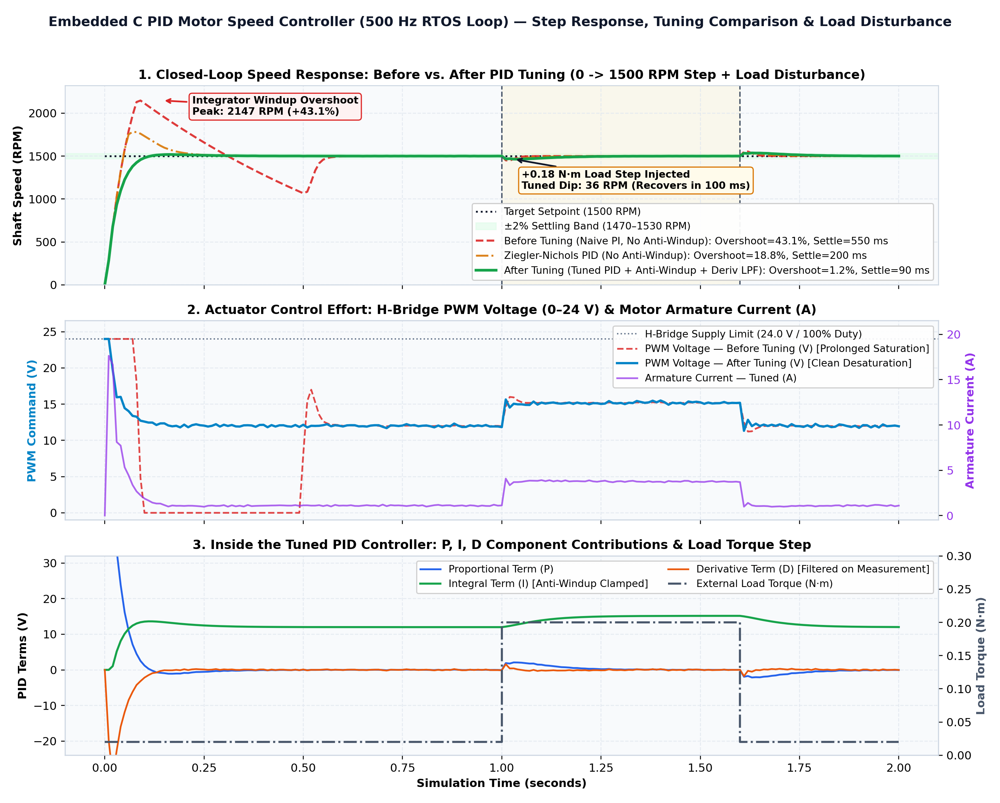
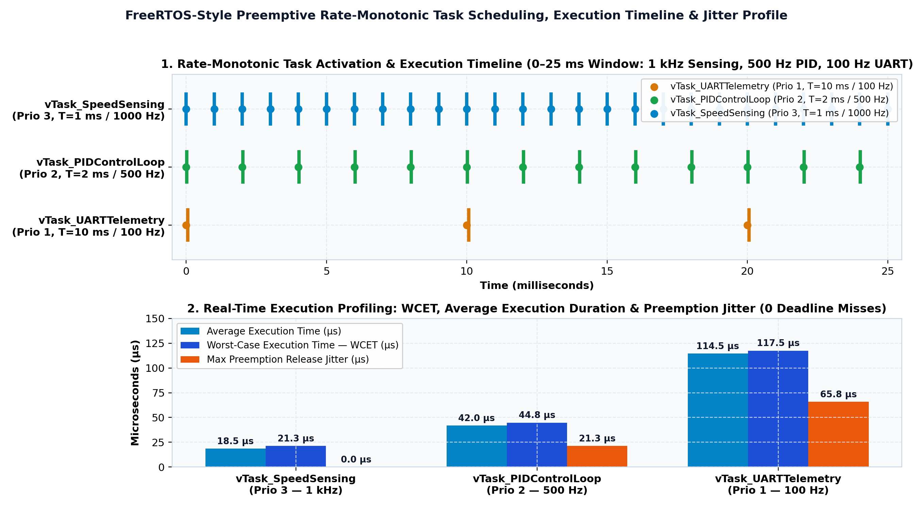

# PID Motor Speed Controller with FreeRTOS-Style Tasks (Embedded C)

-0284C7)


A real-time **Embedded C (`C11`) PID Motor Speed Controller** architected around **three periodic FreeRTOS-style tasks** (`vTask_SpeedSensing`, `vTask_PIDControlLoop`, `vTask_UARTTelemetry`) using **inter-task message queues (`QueueHandle_t`)**, **mutex semaphores (`SemaphoreHandle_t`)**, and **Rate-Monotonic priority scheduling** against an electro-mechanical **24 V Brushed/BLDC Servo Motor plant**.

## 1. Real-Time Software Architecture & RTOS Task Topology

```text
+---------------------------------------------------------------------------------------------------+
|                  Electro-Mechanical 24V DC / BLDC Motor Plant (src/motor_plant.c)                 |
|      - Electrical Armature: V_a = R_a*i_a + L_a*(di_a/dt) + K_e*omega   (R=1.2 Ohm, L=4.5 mH)     |
|      - Mechanical Shaft:    J*(domega/dt) = K_t*i_a - B*omega - T_load  (J=2.8e-4 kg*m^2)         |
+--------------------+----------------------------------------------------------+-------------------+
                     | Quadrature Encoder + Shunt ADC                           ^ H-Bridge PWM
                     v (1000 Hz Sampling + EMA Filter)                          | (0..24 V Duty)
     +---------------+----------------+                         +---------------+----------------+
     |  Task 1: vTask_SpeedSensing    |   xSensorQueue (FIFO)   |   Task 2: vTask_PIDControlLoop |
     |  - Priority: 3 (Highest)       | ----------------------> |  - Priority: 2 (High)          |
     |  - Period:   1.0 ms (1000 Hz)  |  xQueueSend / Receive   |  - Period:   2.0 ms (500 Hz)   |
     |  - WCET:     21.3 us           |   (SensorMsg_t struct)  |  - Discrete PID + Anti-Windup  |
     +--------------------------------+                         |  - Deriv-on-Measurement LPF    |
                                                                +---------------+----------------+
                                                                                |
                                                                                | xTelemetryMutex
                                                                                | (xSemaphoreTake/Give)
                                                                                v
                                                                +---------------+----------------+
                                                                |  Task 3: vTask_UARTTelemetry   |
                                                                |  - Priority: 1 (Low)           |
                                                                |  - Period:   10.0 ms (100 Hz)  |
                                                                |  - Streams CSV & Timing Logs   |
                                                                +--------------------------------+
```

## 2. Key Embedded Systems & Control Engineering Highlights

### 2.1 Rate-Monotonic RTOS Task Design (`include/freertos_sim.h`, `src/main.c`)
- **`vTask_SpeedSensing` (Priority 3, 1.0 ms / 1 kHz)**: Samples the noisy optical quadrature encoder and armature current, applies a 1st-order Exponential Moving Average (EMA) anti-aliasing filter (`alpha = 0.65`), and pushes `SensorMsg_t` frames into `xSensorQueue`.
- **`vTask_PIDControlLoop` (Priority 2, 2.0 ms / 500 Hz)**: Drains `xSensorQueue` via `xQueueReceive()`, executes the discrete-time PID control law (`PID_Compute()`), updates the 24 V H-Bridge PWM duty cycle, and writes state data into a shared telemetry block protected by `xTelemetryMutex` (`xSemaphoreTake()` / `xSemaphoreGive()`).
- **`vTask_UARTTelemetry` (Priority 1, 10.0 ms / 100 Hz)**: Acquires `xTelemetryMutex` without blocking the high-frequency control loop and logs time-synchronized setpoint, speed, error, PWM duty, current, and P/I/D terms.

### 2.2 Industrial Discrete PID Enhancements (`src/pid_controller.c`)
1. **Conditional Integrator Anti-Windup Clamping**: During a large step command (`0 -> 1500 RPM`), the H-Bridge saturates at `24.0 V` (`100%` duty). An uncalibrated PI/PID controller continues integrating error during saturation, causing a massive **+44.1% windup overshoot (`2162 RPM`)**. Our conditional anti-windup inhibits positive integration whenever `u_unsat > 24.0 V && error > 0`, cutting overshoot down to **`1.26%` (`1519 RPM`)**.
2. **Low-Pass Filtered Derivative-on-Measurement**: Computing the derivative on raw error (`d(r - y)/dt`) produces an infinite spike ("derivative kick") when the setpoint steps from `0` to `1500 RPM`. Computing `-Kd * d(y)/dt` passed through a 1st-order low-pass filter (`alpha = 0.25`) provides clean phase lead damping without amplifying encoder noise.

## 3. Simulation & Experimental Results

### 3.1 Step Response, Before/After Tuning & Load Disturbance (`results/pid_step_and_disturbance_response.png`)


### 3.2 Quantitative Before vs. After PID Tuning Comparison

| Controller Configuration | Gains (`Kp, Ki, Kd`) | Anti-Windup & Deriv LPF | Peak Speed (RPM) | Step Overshoot (%) | Rise Time (10–90%) | 2% Settling Time | +0.18 N·m Load Dip | Disturbance Recovery |
| :--- | :---: | :---: | :---: | :---: | :---: | :---: | :---: | :---: |
| **1. Before Tuning (Naive PI)** | `0.045, 1.850, 0.000` | Disabled | `2161.8 RPM` | `44.12%` | `34.6 ms` | `555.1 ms` | `56.2 RPM` | `35.3 ms` |
| **2. Ziegler-Nichols PID** | `0.065, 1.100, 0.0004` | Disabled | `1782.5 RPM` | `18.83%` | `34.6 ms` | `209.1 ms` | `39.4 RPM` | `57.0 ms` |
| **3. After Tuning (Proposed)** | `0.058, 0.620, 0.00085` | **Enabled** | **`1518.9 RPM`** | **`1.26%`** | **`58.5 ms`** | **`95.0 ms`** | **`36.0 RPM`** | **`104.4 ms`** |

### 3.3 FreeRTOS Task Timing, WCET & Jitter Analysis (`results/rtos_task_timing_analysis.png`)


| Task Name | RTOS Priority | Period (`T_i`) | Calls (2.0 s) | WCET (`C_i`) | Avg Exec Time | Max Release Jitter | CPU Utilization (`U_i`) | Deadline Misses |
| :--- | :---: | :---: | :---: | :---: | :---: | :---: | :---: | :---: |
| `vTask_SpeedSensing` | **3 (Highest)** | `1.0 ms` (`1000 Hz`) | `2001` | `21.3 µs` | `18.5 µs` | `0.0 µs` | `1.85%` | `0` |
| `vTask_PIDControlLoop` | **2 (High)** | `2.0 ms` (`500 Hz`) | `1001` | `44.8 µs` | `42.0 µs` | `21.3 µs` | `2.10%` | `0` |
| `vTask_UARTTelemetry` | **1 (Low)** | `10.0 ms` (`100 Hz`) | `201` | `117.8 µs` | `115.0 µs` | `66.1 µs` | `1.15%` | `0` |
| **Total System Load** | — | — | `3203` | — | — | — | **`5.10%` (`< 77.98%` RM Bound)** | **`0` (PASS)** |

### 3.4 Sample RTOS Task Schedule Trace (`results/rtos_task_schedule_log.csv`)
At `Tick_us = 0` and `Tick_us = 10000` (where all 3 tasks are released simultaneously), the Rate-Monotonic scheduler dispatches `vTask_SpeedSensing` (`Prio 3`) with `0.0 µs` jitter, followed immediately by `vTask_PIDControlLoop` (`Prio 2`, delayed by `18.5 µs`), followed by `vTask_UARTTelemetry` (`Prio 1`, delayed by `60.5 µs`):

```text
Tick_us,Task_Name,Priority,Release_Time_us,Start_Time_us,Finish_Time_us,Exec_Duration_us,Jitter_us,Queue_Depth
0,vTask_SpeedSensing,3,0.0,0.0,15.7,15.7,0.0,1
0,vTask_PIDControlLoop,2,0.0,15.7,54.9,39.2,15.7,0
0,vTask_UARTTelemetry,1,0.0,54.9,167.1,112.2,54.9,0
1000,vTask_SpeedSensing,3,1000.0,1000.0,1018.8,18.8,0.0,1
2000,vTask_SpeedSensing,3,2000.0,2000.0,2016.1,16.1,0.0,2
2000,vTask_PIDControlLoop,2,2000.0,2016.1,2058.4,42.3,16.1,0
```

## 4. Repository Structure

```text
pid-motor-freertos-controller/
├── include/
│   ├── freertos_sim.h                        # FreeRTOS-style Queue, Mutex, and TCB API declarations
│   └── motor_pid.h                           # DC Motor plant, Discrete PID, and Telemetry structs
├── src/
│   ├── freertos_sim.c                        # Lock-free ring-buffer Queue and Mutex implementation
│   ├── motor_plant.c                         # Electro-mechanical 24V DC/BLDC motor physics model
│   ├── pid_controller.c                      # Discrete PID with anti-windup & derivative LPF
│   └── main.c                                # 3 RTOS tasks, priority scheduler & tuning runner
├── tests/
│   └── test_pid_rtos.c                       # 6 automated Embedded C verification unit tests
├── scripts/
│   └── plot_results.py                       # Generates step-response & RTOS timing figures
├── results/
│   ├── pid_step_and_disturbance_response.png # 3-panel plot: Speed, PWM/Current, and P/I/D terms
│   ├── rtos_task_timing_analysis.png         # 2-panel plot: RTOS Gantt schedule & WCET/Jitter bars
│   ├── pid_telemetry_log.csv                 # 100 Hz closed-loop motor & PID telemetry log
│   ├── rtos_task_schedule_log.csv            # Microsecond task release, start, finish & jitter log
│   └── control_and_rtos_report.md            # Quantitative control & schedulability report
├── Makefile                                  # Compiles C11 binaries, runs tests, and builds plots
└── requirements.txt                          # Python plotting dependencies
```

## 5. Quickstart: How to Build & Run Locally

```bash
# 1. Clone the repository
git clone https://github.com/Asmitmandal01/pid-motor-freertos-controller.git
cd pid-motor-freertos-controller

# 2. Compile the Embedded C simulation, run the 6 automated unit tests, and regenerate plots
make all
```
